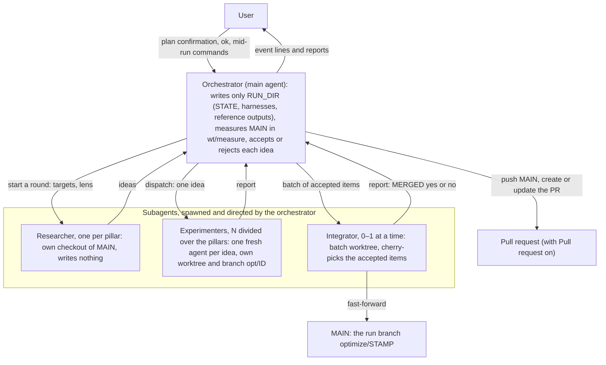

# claude-code-tools

A collection of reusable [Claude Code](https://claude.com/claude-code) tools: slash commands, MCP server configs, and agent workflows. Some tools also ship a ChatGPT-compatible version under `chatgpt/`.

[Quickstart](#quickstart) · [Commands](#commands) · [Skills](#skills) · [Plugin](#plugin-preference-tracker) · [ChatGPT](#chatgpt) · [MCP](#mcp) · [Layout](#repository-layout)

## Quickstart

Install the `preference-tracker` plugin from this repository's marketplace (`prucsakos-tools`):

```bash
claude plugin marketplace add prucsakos/claude-code-tools
claude plugin install preference-tracker@prucsakos-tools
```

Install a command (here `/team`) for every project:

```bash
git clone https://github.com/prucsakos/claude-code-tools && cd claude-code-tools
cp commands/team.md ~/.claude/commands/
```

Install a Codex skill (here `explain`), from the same clone:

```bash
cp -R skills/explain ~/.codex/skills/
```

## Tools

| Tool | What it does |
|------|--------------|
| [`/team`](commands/team.md) | Command: run N parallel Haiku workers on a task |
| [`/explain`](commands/explain.md) | Command: explain a concept in Simplified English |
| [`/explain-simple`](commands/explain-simple.md) | Command: `/explain` without the fixed structure |
| [`/full-code-audit`](commands/full-code-audit.md) | Command: load a folder's source code into context |
| [`/my-code-simplify`](commands/my-code-simplify.md) | Command: simplify current changes, keep behavior |
| [`explain`](skills/explain/) | Codex skill: version of `/explain` |
| [`explain-simple`](skills/explain-simple/) | Codex skill: version of `/explain-simple` |
| [`my-iterative-optimization`](skills/my-iterative-optimization/) | Skill: orchestrate parallel researchers, experimenters and an integrator to improve a project |
| [`teaching-video`](skills/teaching-video/) | Skill: make a narrated teaching or tutorial video |
| [`preference-tracker`](plugins/preference-tracker/) | Plugin: record taste notes to a private repo |
| [`full-code-audit`](chatgpt/full-code-audit.md) | ChatGPT prompt: version of `/full-code-audit` |
| [`my-iterative-optimization` (ChatGPT fork)](chatgpt/my-iterative-optimization/) | ChatGPT skill: independently maintained fork of the Claude Code original |
| [BlenderMCP](https://github.com/ahujasid/blender-mcp) | MCP: connect an AI client to Blender |

## Commands

Clone this repository and copy a command file into your commands directory:

```bash
git clone https://github.com/prucsakos/claude-code-tools && cd claude-code-tools

# Available in every project (user-level)
cp commands/team.md ~/.claude/commands/

# Or per-project
cp commands/team.md your-project/.claude/commands/
```

Then use it inside Claude Code. Arguments come from each command's `argument-hint`:

| Command | Arguments | Example |
|---------|-----------|---------|
| `/team` | `[N] "task description"` | `/team 4 "Refactor the API layer and add tests"` |
| `/explain` | `<topic> [--diagram mermaid\|image] [--web static\|interactive] [--video storyboard\|full]` | `/explain "Kalman filter" --diagram mermaid` |
| `/explain-simple` | `<topic> [--diagram mermaid\|image] [--web static\|interactive] [--video storyboard\|full]` | `/explain-simple "Kalman filter"` |
| `/full-code-audit` | `path to the folder to load` | `/full-code-audit src/` |
| `/my-code-simplify` | `optional scope (files, folder, PR); defaults to the current changes` | `/my-code-simplify` |

`/team` without N lets Claude pick the team size, e.g. `/team "Audit the codebase for security issues"`.

### `/team`

Spin up a team of N parallel Haiku workers to tackle a task.

```bash
cp commands/team.md ~/.claude/commands/
```

### `/explain`

Explain a concept in ASD-STE100 Simplified Technical English via reusable mental models, linked to a personal Concept Vocabulary repo.

```bash
cp commands/explain.md ~/.claude/commands/
```

### `/explain-simple`

Same ASD-STE100 rules and Concept Vocabulary as `/explain`, without the fixed explanation structure.

```bash
cp commands/explain-simple.md ~/.claude/commands/
```

### `/full-code-audit`

Load a folder's production source code into context, verbatim and unanalyzed.

```bash
cp commands/full-code-audit.md ~/.claude/commands/
```

### `/my-code-simplify`

Aggressively simplify the current changes and prune their tests, preserving behavior.

```bash
cp commands/my-code-simplify.md ~/.claude/commands/
```

## Skills

### `explain` and `explain-simple` (Codex)

Codex versions of the `/explain` and `/explain-simple` commands. Copy a skill folder into your Codex skills directory:

```bash
cp -R skills/explain ~/.codex/skills/
cp -R skills/explain-simple ~/.codex/skills/
```

Then invoke it as `$explain` (or `$explain-simple`) in Codex.

### `my-iterative-optimization` (Claude Code)

Claude Code skill that orchestrates parallel work on a project: one orchestrator directs researchers, experimenters and an integrator, with fixed roles and time budgets, to improve the targets you pick. Optimizing a metric and building features are cases of it. Pick targets inside pillars from four groups (Product: Performance, UX, UI, Features · Reach: Accessibility, SEO, i18n · Engineering: Quality, DX, OX, Security · Code health: Code hygiene, Dependency health, Documentation). Optimize targets (e.g. Performance: Speed or Memory) improve a measurable metric; build targets (UI: Redesign, New screens · Features) add new features or designs against fixed acceptance criteria; judged targets (e.g. the wording of a thesis, research or web fact-finding) have no metric and no tests, so each idea is accepted on a rubric fixed before dispatch, and the orchestrator judges it from before/after evidence. You may also define your own pillars and targets, of any of the three kinds. Uses one researcher per pillar that searches widely and sends both conservative and bold ideas, N parallel experimenters divided evenly over the pillars, and one integrator that migrates accepted changes to main in batches. Profiles `low`, `medium` and `high` set the spend; mode `auto` decides on its own, `review` asks you to approve each batch.



- Only the integrator writes MAIN: it fast-forwards MAIN to its batch branch. The orchestrator writes only RUN_DIR and never edits the project's code.
- Researchers and experimenters are per pillar: one researcher per selected pillar, and the N experimenters are divided evenly over the pillars.
- No arrow joins two subagents, or a subagent and the user: the orchestrator spawns each subagent, and each one reaches it with SendMessage `to: "main"`.

It is a Claude Code skill, so copy it into your Claude Code skills directory. These commands replace an earlier install of this skill only and leave your other skills alone:

```bash
mkdir -p ~/.claude/skills
rm -rf ~/.claude/skills/my-iterative-optimization
cp -R skills/my-iterative-optimization ~/.claude/skills/
```

To learn whether Claude Code will load the repo's current text or a stale install (after editing the skill or after a merge), run `bash skills/my-iterative-optimization/install-check.sh`: it compares the two copies file by file, ignoring line endings, and prints `installed copy matches (<n> files)`, one `FAIL` line per differing, missing or extra file, or `not installed at <path>`; it changes nothing.

Then use it inside Claude Code:

```
/my-iterative-optimization "Make scripts/build_report.py faster without changing its output"
/my-iterative-optimization "Improve this project"   # offers the pillars as a multiple choice, then proposes targets
/my-iterative-optimization "Improve DX and Quality"
/my-iterative-optimization high auto "Make the build faster"   # profile and mode are not proposed in the plan
/my-iterative-optimization low review "Improve Code hygiene"
/my-iterative-optimization review "Make it faster and add a CSV export of reports"   # an optimize and a build target
/my-iterative-optimization "Improve the wording of my thesis in thesis/"   # a judged target, accepted on a rubric
/my-iterative-optimization "Find more sources for the open questions in research/notes.md"   # judged: research discovery
/my-iterative-optimization "Fact-check the claims in facts.md on the web"   # judged, or optimize on verified-claim count
```

To end a run, say `stop` (stops the running agents at once) or `finish` (no new work; the running experimenters and the integrator finish, their accepted ideas go into one last batch, then the run stops); plain words work too. Mid-run, `status` prints the full report and the time left of each running agent, and `set <value> <new>` changes T_ITER, T_RESEARCH, a target's cap or a pillar's experimenters from the next dispatch on (`set cap Features 3`). `idea <Target>: <text>` queues your own idea, with acceptance criteria the run writes, ahead of the researchers' ideas for that target's pillar. `pause` starts no new work while running agents finish, and keeps the queue and worktrees; `resume` fills the free slots again. Set `End` in the plan (`18:00` or `3h`) or mid-run (`set End 19:30`), and the run starts `finish` on its own one T_ITER before that time.

To list what runs left in a repo, at any time, run `bash skills/my-iterative-optimization/footprint.sh <REPO>`: it prints each leftover with its delete command and deletes nothing.

After editing the skill, run `bash skills/my-iterative-optimization/check.sh`: it checks the SKILL.md frontmatter, that each prompt template's placeholder table lists exactly the placeholders its prompt uses, that every `section N` reference has a `## N.` heading in SKILL.md, and that every reply literal SKILL.md acts on (such as `MERGED: yes` or `timeout-partial`) is defined in a role prompt's reply format, then prints `OK` or one `FAIL` line per defect.

After a change to `measure.sh`, run `bash skills/my-iterative-optimization/measure-check.sh`; it prints `OK`, or one `FAIL` line per broken case.

Each experimenter commit carries the trailers `Optimize-Run: <YYYYMMDD-HHMM>` (the run's start time) and `Target: <Pillar>: <Target>`, so `git log --grep 'Optimize-Run: <stamp>'` lists one run's commits and `git log --grep 'Target: <Pillar>: <Target>'` one target's.

After you edit the skill, run `bash skills/my-iterative-optimization/source-check.sh`: it checks that every plan input, setup step and section paragraph that a prompt's placeholder table names still exists in `SKILL.md`, and prints each row that points at a missing one.

After you change a check script or the skill's layout, run `bash skills/my-iterative-optimization/seed-check.sh`: it seeds known defects (an unlisted placeholder, a `section 99` reference, a removed reply field, a renumbered setup step, a changed frontmatter name) into a temp copy of the skill and prints `OK (<n> seeds caught)`, or one `MISSED <seed>` line per defect its check let through. To cover a new defect class, add one row to its seed table.

After you edit the skill, run `bash skills/my-iterative-optimization/format-check.sh`: it checks that every table row in the skill's `.md` files and in this section has as many cells as its header row, and that every `.sh` file has LF line endings and passes `bash -n`, then prints `OK` or one `FAIL <file>:<line>` line per defect.

### `teaching-video` (Claude Code)

Claude Code skill: turns a topic or study material (notes, a chapter, a paper, code) into a short MP4 that teaches it. Claude plans the lesson (hook, intuition, mechanism, worked example, pitfall, recap, check question), writes the narration and a storyboard, and builds one animated HTML scene per step. `make_video.py` narrates each beat with text-to-speech, seeks the scenes frame by frame in headless Chromium so the picture follows the narration, and encodes video, voice and captions with ffmpeg. Narration backends: `edge` (online Microsoft neural voices, including Hungarian; the narration text goes to Microsoft), `sapi` (Windows voices, offline) and `none` (captions only). The video is in English unless you name another language. Mode `storyboard` stops after the storyboard.

**Requires**

- Python 3.9+ (`python3` on macOS and Linux, `python` or `py -3` on Windows), `ffmpeg` and `ffprobe` on your PATH
- `python -m pip install playwright edge-tts`, then `python -m playwright install chromium`
- `python skills/teaching-video/make_video.py --doctor` checks all of these and prints the install command for each missing tool; add `--install` to run those commands and check again

```bash
cp -R skills/teaching-video ~/.claude/skills/
```

Then use it inside Claude Code:

```
/teaching-video "How a hash map finds a value"
/teaching-video storyboard "Bayes' theorem for doctors reading test results"
/teaching-video "Explain docs/architecture.md to new team members, in Hungarian"   # internal material: no online voice unless you allow it
```

## Plugin: preference-tracker

Claude Code plugin: after each Claude turn, a background worker writes taste notes when you had to step in (a correction, a follow-up question, something unclear, or a request Claude could have handled itself) and pushes them to `preferences/preferences.jsonl` in a private repository.

This repository is also a Claude Code plugin marketplace (`prucsakos-tools`):

```bash
claude plugin marketplace add prucsakos/claude-code-tools
claude plugin install preference-tracker@prucsakos-tools
```

**Requires**

- `node` and `git` on your PATH
- push access to the preference repository
- in that repository, the `.gitattributes` line `preferences/preferences.jsonl merge=union`, so notes from several machines merge

**Options**

| Option | Default (when empty) | What it sets |
|---|---|---|
| `repo_url` | `https://github.com/prucsakos/claude-preferences.git` (my private repository) | Git URL of the repository that stores the notes. Set it to use your own. |
| `model` | `sonnet` | Model alias or name that extracts the notes from your messages. |

**When it writes a note**

A note is written when one of your messages shows one of these triggers:

- `correction`: you corrected, rejected or redirected what Claude did, or told it how you want things done.
- `clarification_question`: you asked a follow-up question about Claude's response or work, which shows information Claude could have given without being asked.
- `unclear_response`: you did not understand Claude's response.
- `avoidable_request`: you asked Claude to do something it could have done without asking.

**What a note looks like**

Each note is one line of JSON; it is shown formatted here. It records the trigger, the taste note (`note`), what Claude should do next time (`next_time`), a short summary of the situation, what Claude did and your words. `category` is one of `communication`, `code-style`, `architecture`, `testing`, `workflow`, `tooling`, `git`, `documentation` or `other`; `scope` is `global` or `project`; `basis` is `stated` when you said the preference in words, `inferred` when it was deduced from a question or reaction; `supersedes` is the `id` of an older note that this one replaces, or `null`.

```json
{
  "id": "pref_3f9a1c2b7d4e",
  "trigger": "avoidable_request",
  "note": "After a bug fix, the user wants Claude to run the existing tests before it reports, not ask whether to run them.",
  "next_time": "Run the project's test command after a fix and report the result.",
  "category": "testing",
  "scope": "global",
  "basis": "stated",
  "context": {
    "situation": "Claude fixed a date-parsing bug and asked whether to run the tests.",
    "claude_action": "Ended its turn with \"Shall I run the tests?\"",
    "user_quote": "yes, run them"
  },
  "supersedes": null,
  "source": {
    "project": "my-app",
    "session_id": "0b6c2f4e-8a1d-4c3b-9e57-2d8f1a6b3c90",
    "prompt_uuid": "5e2d9a7c-1f3b-4a8e-b6c4-7d0e2f9a1b35",
    "timestamp": "2026-10-14T09:12:45.318Z"
  }
}
```

**Privacy:** before a note is written, a pattern check (`plugins/preference-tracker/scripts/redact.mjs`) removes tokens, keys, passwords, email addresses and URLs from its text.

**Errors:** if a background run fails, the error is shown after the next Claude turn.

Example: after installing, work in Claude Code as usual. When you correct Claude, the next turn's background run appends a note to `preferences/preferences.jsonl` in the configured repository.

## ChatGPT

### `my-iterative-optimization` — fork

[`chatgpt/my-iterative-optimization/`](chatgpt/my-iterative-optimization/) is a **ChatGPT fork, not the original** [`Claude Code skill`](skills/my-iterative-optimization/). The source revision and port differences are recorded in [FORK.md](chatgpt/my-iterative-optimization/FORK.md). The original remains unchanged.

This is a complete skill directory with `SKILL.md`, role/workflow references, OpenAI UI metadata and a Python measurement helper. Provide the whole directory's files to ChatGPT's skill editor or `@skill-creator`; supported installation options depend on your account and surface (see the [OpenAI skill guide](https://learn.chatgpt.com/docs/build-skills)). Invoke the installed skill as `@my-iterative-optimization`. The same folder can be installed as a Codex skill and invoked as `$my-iterative-optimization`.

Execution requires a writable git checkout, git, Python 3.9+, a shell and the project's dependencies. Delegation uses the host's available worker tools and respects its limits; otherwise experiments run sequentially. Without executable repository access it produces a plan/patch and identifies unverified checks. It never assumes unattended work continues after a chat ends. See [usage and examples](chatgpt/my-iterative-optimization/FORK.md#using-this-fork).

### `full-code-audit`

ChatGPT/custom-GPT version of the full-code-audit command. [`chatgpt/full-code-audit.md`](chatgpt/full-code-audit.md) is plain prompt text, not an installable skill. Use one of:

- **Custom GPT:** paste the file's content into the GPT's *Instructions* field.
- **One-off chat:** paste the prompt, replace `{{TARGET}}` with what you're auditing (or drop that line and paste/upload the code right after the prompt).

## MCP

MCP server configs live in [`mcps/`](mcps/). See that folder's README for setup.

### BlenderMCP

Related project: [BlenderMCP](https://github.com/ahujasid/blender-mcp) connects MCP-compatible AI clients to Blender through an MCP server and Blender add-on. Install and example usage are in its README; setup notes for this repository are in [`mcps/`](mcps/).

## Plugins I use

Claude Code plugins enabled in my user settings (`name@marketplace`).

| Plugin | Marketplace |
|--------|-------------|
| `you-should-know` (`cc-plugin-you-should-know`) | `builtin` |
| `code-review` | `anthropics/claude-plugins-official` |
| `feature-dev` | `anthropics/claude-plugins-official` |
| `security-guidance` | `anthropics/claude-plugins-official` |
| `playwright` | `anthropics/claude-plugins-official` |
| `linear` | `anthropics/claude-plugins-official` |
| `github` | `anthropics/claude-plugins-official` |

## Repository layout

```
.claude-plugin/  # Plugin marketplace manifest
commands/        # Slash commands (markdown files, one per command)
mcps/            # MCP server configurations and docs
plugins/         # Claude Code plugins (one folder per plugin)
skills/          # Reusable skills, Codex unless noted (one self-contained folder per skill)
chatgpt/         # ChatGPT prompts and complete skill forks (see each tool's docs)
```

## Contributing

PRs welcome. Keep each tool self-contained and documented at the top of its file.
